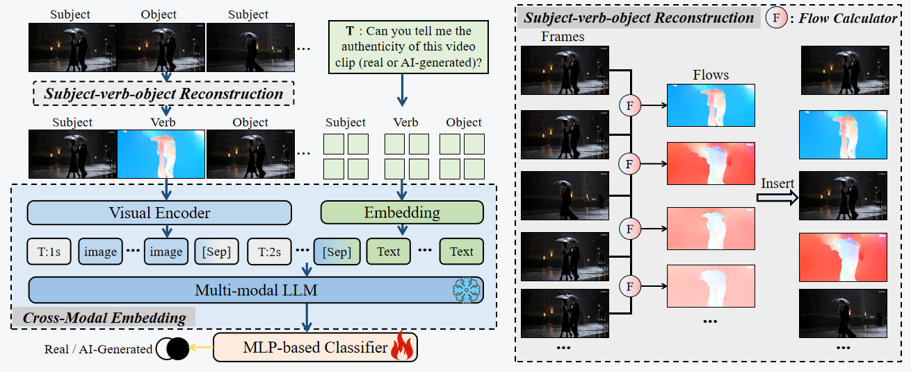

# SiVT: Sentence-Inspired Video Tokenization with MLLM for AI-Generated Video Detection

  
  
  

Official website for the **IJCNN 2026** main track paper: 
> **“SiVT: Sentence-Inspired Video Tokenization with MLLM for AI-Generated Video Detection"**

**Authors:** **Junjie She**, Peisong He, Haonan Qiu, Leyao Zhu, Weina Niu.

---

## 🚀 News
- **[2026.03]** We have released the official repository for SiVT.

## 📖 Overview

*Figure: The framework of SiVT. We propose a Sentence-Inspired Video Tokenization method that leverages MLLM to enhance AI-generated video detection.*

## 🛠️ Methodology

**SiVT** (Sentence-inspired Video Tokenization) redefines video data as a structured, linguistic-like sequence to activate MLLM's inherent sensitivity to generation artifacts.

* **SVO Reconstruction**: We reorganize raw video into **Subject-Verb-Object** triplets $[f_t, o_t, f_{t+1}]$, where video frames $f_t$ act as nouns and inter-frame optical flows $o_t$ act as verbs.
* **Syntactic Alignment**: The visual stream is partitioned into discrete "vision sentences," anchored by **timestamp tokens** and **comma separators** to emulate natural language syntax.
* **Cross-Modal Inference**: These structured sequences are jointly embedded with textual probes into a frozen **VideoLLaMA3** backbone to extract high-level semantic features.
* **Authenticity Classification**: A lightweight, trainable **MLP classifier** processes the final hidden states to predict whether the video is **Real** or **AI-generated**.

## 🔗 Acknowledgement
We sincerely thank the following open-source projects for their great contributions to the community:
* [VideoLLaMA3](https://github.com/DAMO-NLP-SG/VideoLLaMA3) - For advanced video-language modeling.
* [MM-Det](https://github.com/SparkleXFantasy/MM-Det) - For providing the DVF datasets and detection benchmarks.

## 📜 License
The license of the code can be found in the [LICENSE.md](LICENSE.md) file.

## 📧 Contact
If you have any questions or are interested in our work, please feel free to contact:
- **Junjie She**: [shejunjie@stu.scu.edu.cn](mailto:shejunjie@stu.scu.edu.cn)
- School of Cyber Science and Engineering, Sichuan University.
